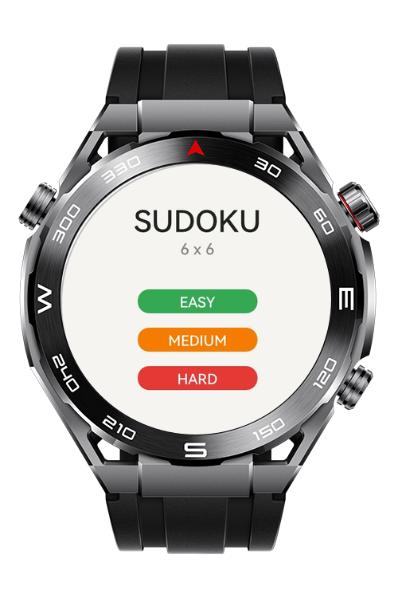
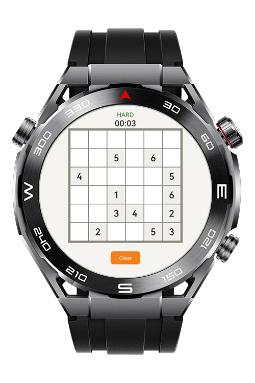
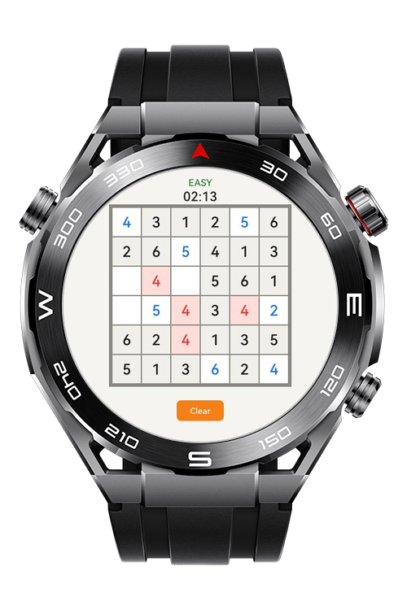
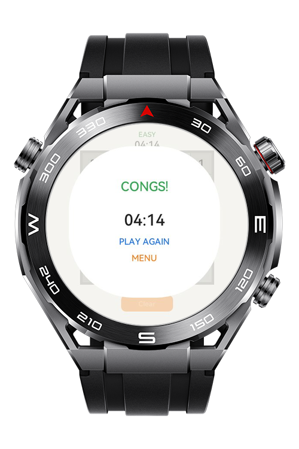

> **Note:** To access all shared projects, get information about environment setup, and view other guides, please visit [Explore-In-HMOS Index](https://github.com/Explore-In-HMOS/hmos-index).

# Sudoku LiteWearable

Sudoku LiteWearable is a touch-first, logic-based puzzle game built for HarmonyOS Lite wearable devices. The project features a 6x6 grid optimized for circular watch screens, offering a smooth gameplay experience with real-time conflict detection and dynamic difficulty scaling.
# Preview

<div>
  
  
  
  
</div>

# Use Cases

1. Players begin at the level selection screen, choosing between EASY, MEDIUM, or HARD difficulty. This selection determines the number of pre-filled "fixed" cells on the board.

2. Touch-Based Number Input
   Players tap any empty or non-fixed cell to cycle through numbers 1 to 6. The game uses a circular increment logic (1-2-3-4-5-6-Empty) to allow quick inputs without a digital keyboard.

3. Real-Time Conflict Detection
   The game engine automatically validates every move against Sudoku rules (row, column, and 2x3 block constraints). Conflicting numbers are instantly highlighted in red to guide the player.

4. Manage Game Flow
   Players can track their solving time via an on-screen timer, clear their manual inputs to restart a puzzle, or return to the main menu at any time. Upon completion, a victory overlay displays the final time and a achievement medal.

# Tech Stack

* **Languages:** JavaScript, HML, CSS
* **Platform:** HarmonyOS Lite JS
* **Framework:** HarmonyOS Lite JS page model (`MainAbility`)
* **Build Tools:** DevEco Studio, Hvigor
* **Game Logic:** Custom 6x6 matrix generator, backtracking-based solution validator, and real-time conflict detection engine.

# Directory Structure

```
|-- build-profile.json5
|-- hvigorfile.ts
|-- oh-package.json5
`-- entry/
    `-- src/main/
        |-- config.json
        |-- js/MainAbility/
        |   |-- app.js
        |   |-- common/
        |   |   |-- images/
        |   |   |   `-- medal.png
        |   |   |-- sudoku_engine.js
        |   |   `-- sudoku_utils.js
        |   |-- i18n/
        |   |   |-- en-US.json
        |   |   `-- zh-CN.json
        |   `-- pages/
        |       |-- index/
        |       |   |-- index.css
        |       |   |-- index.hml
        |       |   `-- index.js
        |       `-- level/
        |           |-- level.css
        |           |-- level.hml
        |           `-- level.js
        `-- resources/base/
            |-- element/string.json
            `-- media/
                |-- icon.png
                `-[.hvigor](.hvigor)- icon_small.png
        
```
# Constraints and Restrictions

## Supported Device

-Huawei Sport (Lite) Watch GT 4/5/6
-Huawei Sport (Lite) GT4/5 Pro
-Huawei Sport (Lite) Fit 3/4
-Huawei Sport (Lite) D2
-Huawei Sport (Lite) Ultimate
# LICENSE

**Sudoku Lite Wearable** is distributed under the terms of the MIT License.
See the [LICENSE](/LICENSE) for more information.